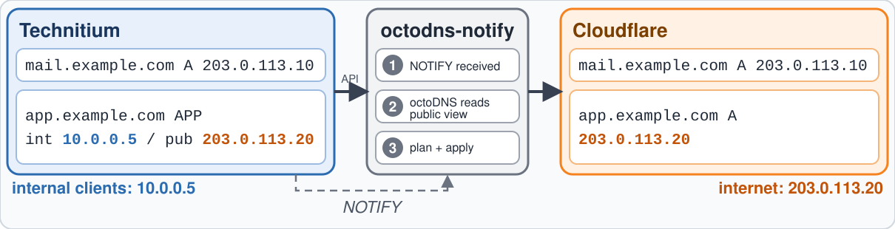

# octodns-notify

[](https://github.com/octodns/octodns)

**Runs [octoDNS](https://github.com/octodns/octodns) for a zone when a DNS NOTIFY for it arrives.**



This repo holds two parts:

- `octodns-notify`, a generic notifier: any primary that sends NOTIFY can trigger a
  sync with any octoDNS source and target.
- `octodns_technitium`, an octoDNS source for [Technitium](https://technitium.com/dns/).
  Technitium stays the source: a zone change is published to Cloudflare (or any other
  octoDNS target) within seconds, and with Split Horizon only the public answers go out.

## How it works

- A UDP listener answers a NOTIFY for a zone of the octoDNS config with NOERROR and
  queues the zone. Other zones and other queries get REFUSED.
- One worker runs `octodns-sync --config-file FILE [--doit] ZONE` per queued zone,
  one at a time. A zone is queued at most once: NOTIFYs that arrive while its sync
  runs lead to one more sync afterwards.
- A failed sync is logged and retried after 30 seconds.
- All zones are synced at start and then every `--resync` seconds. NOTIFY over UDP
  can get lost, and the target can drift without the primary noticing; the periodic
  run repairs both.
- Logs go to stdout. SIGTERM stops the listener and exits after a running sync.

Wildcard zone names in the config are skipped. There is no TSIG and no source
allowlist: a forged NOTIFY for a known zone only causes one extra sync.

## Technitium NOTIFY

In the zone options of each zone, under Zone Notify, choose "Specified name servers"
and enter the address of this service. Technitium sends NOTIFY over UDP to port 53,
so on Kubernetes the Service maps UDP 53 to the container port 5353 and the
container needs no privileges:

```yaml
apiVersion: v1
kind: Service
metadata:
  name: octodns-notify
spec:
  ports:
    - name: notify
      protocol: UDP
      port: 53
      targetPort: 5353
  selector:
    app: octodns-notify
```

The Service ClusterIP is the address for Technitium.

## Technitium source

```yaml
providers:
  technitium:
    class: octodns_technitium.TechnitiumSource
    url: https://dns.example.com
    token: env/TECHNITIUM_TOKEN  # needs View on the zones
    # view: public               # Split Horizon view of SimpleAddress records
    # public_only: true          # leave out addresses that are not public
    # timeout: 30
  cloudflare:
    class: octodns_cloudflare.CloudflareProvider
    token: env/CLOUDFLARE_API_TOKEN
    min_ttl: 60                  # the Cloudflare minimum, octoDNS defaults to 120

# Optional: only touch the records octoDNS created, the rest of the zone is left alone.
processors:
  ownership:
    class: octodns.processor.ownership.OwnershipProcessor

zones:
  example.com.:
    sources: [technitium]
    processors: [ownership]
    targets: [cloudflare]
```

The zone must exist in Technitium; octoDNS names carry a trailing dot. Syncs are dry
runs unless `--doit` is given.

### Record mapping

| Technitium | octoDNS |
|---|---|
| A, AAAA, CNAME, MX, TXT, SRV, CAA | as is |
| NS | as is, the apex NS is skipped |
| APP `SimpleAddress` | the addresses of the `view` split into A and AAAA |
| SOA, other APP, DNSSEC | skipped |
| disabled records | skipped |

- Values of one name and type form one record set; duplicates are dropped and the
  lowest TTL wins.
- A comment containing `cf:proxied` on an A, AAAA or CNAME record (or on the APP
  record behind the addresses) sets `octodns: {cloudflare: {proxied: true}}`.
- `;` in TXT values is escaped as `\;`.
- An APP record with unreadable data fails the run, as skipping it would delete the
  addresses of its name in the target.
- Addresses that are not public (private, CGNAT, ULA, loopback, link-local) are left
  out with one warning per address. `public_only: false` keeps them.

## Usage

```sh
octodns-notify --config-file config.yaml [--doit] [--listen 0.0.0.0] [--port 5353] [--resync 600]
```

| Argument | Default | |
|---|---|---|
| `--config-file` | | octoDNS config, required |
| `--doit` | off | apply the plan; without it syncs are dry runs |
| `--listen` | `0.0.0.0` | address of the listener |
| `--port` | `5353` | UDP port of the listener |
| `--resync` | `600` | seconds between syncs of all zones, `0` disables |

octoDNS (`octodns-sync`) and the providers named in the config must be installed.

## Images

| Image | Contains | Use for |
|---|---|---|
| `ghcr.io/ruakij/octodns-notify` | octoDNS, the notifier | any other source or target, as a base |
| `ghcr.io/ruakij/octodns-notify-technitium` | the above, the Cloudflare provider, the Technitium source | Technitium to Cloudflare |

```sh
docker run --rm -v ./config.yaml:/config/config.yaml:ro -p 5353:5353/udp \
  -e TECHNITIUM_TOKEN=... -e CLOUDFLARE_API_TOKEN=... \
  ghcr.io/ruakij/octodns-notify-technitium --config-file /config/config.yaml --doit
```

Other providers go into a derived image:

```dockerfile
FROM ghcr.io/ruakij/octodns-notify
USER root
RUN pip install --no-cache-dir octodns-route53
USER 65532:65532
```

## Development

```sh
python -m venv .venv && .venv/bin/pip install -e '.[test]'
.venv/bin/pytest
.venv/bin/ruff check . && .venv/bin/ruff format --check .
docker build --target base .
docker build --target technitium .
```

The wheel contains only the notifier; the Technitium source is copied into the
`technitium` image from `octodns_technitium/`.
